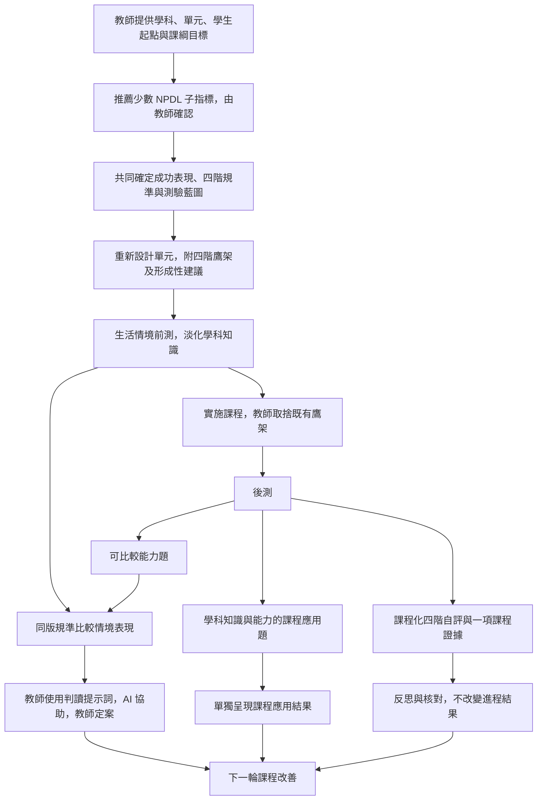

# 課程與前後測設計流程

> 依 2026-10-07 使用者確認的 [[專案/NPDL備課工具/工具設計概念與階段範圍|設計定稿]]。本頁描述待落地的內容流程，不表示現有 App 已支援新增結構或已完成題組校準。

## 流程圖

課中觀察、作業與形成性評量提供教學建議；本階段不送入上圖的進程比較。自評提出的課程證據只送入反思部分。學生暫不參與課程共同設計與決策。

## 一、確認課程起點與目標

教師提供學科、年級、單元、節數、已知學生起點及課綱學習目標。缺少學生背景時保留假設，不推定全班已處於某階。

課綱對應保留條文與來源，分清學習表現、學習內容與核心素養。對應 NPDL 時說明具體活動如何支持該子指標，不把代碼相近當成官方一對一關係。教師確認採用的目標與子指標。

單元先聚焦一至兩項子指標；整體工具涵蓋六大素養。學科知識須支持分析、解釋、選擇或成果品質，不只列出名詞。

## 二、先確定成功表現、規準與測驗藍圖

每個子指標對應同一條關係：

**課綱與學科目的 → 能力成功表現 → 活動練習 → 題目中的可觀察特徵 → 四階判讀依據。**

四階為證據有限、萌芽、發展、精熟，標示工具版及適用課程。描述比較同一表現的品質，不以術語、字數、選項排列或答對題數直接定級。

測驗藍圖需記錄：

| 項目 | 必須交代 |
| --- | --- |
| 目標 | 子指標名稱、判讀項目、可觀察範圍與未觀察部分 |
| 規準 | 教師確認的四階完整敘述、來源及版本 |
| 題目 | 題幹、必要資料、選項、選擇方式、題目與子指標對應 |
| 判讀依據 | 每個選項能支持的判斷特徵與限制；多題如何依規準整合 |
| 前後配對 | 哪些能力題配對；閱讀量、資訊複雜度、推理要求與提示條件 |
| 課程應用 | 後測額外要求的學科知識、應用判準與結果呈現方式 |
| 反思 | 後測自評敘述與活動線索；明示不計入進程判讀 |

情境選擇題是主要題型。選項應反映可辨識的思考或處理差異，不必固定四個選項，更不能預設四個選項就是四階。若題目只能分辨答案是否合宜，便只作該範圍的答題分析；缺少可支持階段的對應規則時，不硬分四階。

## 三、重新設計單元與四階鷹架

依目標安排學科教學、活動任務、必要資料、時間、支持方式與教學檢核。原始教案與教師提供的事實保留；新設計是教師可審查採用的版本，不回寫成原教案或已實施事實。

四要素要指出具體做法。學生共同決策尚未納入時，學習夥伴關係須照實標記該限制；同儕互動、教師回饋與安全參與仍可規劃。數位工具依學習價值及資源條件選用。

以下是「依資料支持判斷」的鷹架示例，用來說明支持差異，不是任何子指標的官方規準：

| 對應支持層次 | 可提供的教學支持 |
| --- | --- |
| 證據有限 | 示範一個資料與主張的連結，再用短問題引導學生找相關資訊。 |
| 萌芽 | 提供主張、證據與理由的整理框架，引導檢查理由是否真的支持主張。 |
| 發展 | 提供比較架構，引導整合多項資料、辨識限制並權衡不同解釋。 |
| 精熟 | 減少結構提示，提供反例或新資訊，要求說明是否與如何修正判斷。 |

各單元依已確認子指標改寫支持內容。支持層次不是固定分組，也不代表教師已判定學生能力。共同目標保留，教師可在課堂中取捨；用了某種鷹架，不能直接定為相應階段。教學鷹架可以有差異，前後測的作答支持則須另外記錄與比較。

## 四、前測與課程實施

前測以生活情境為主，提供判斷所需資訊，淡化未教過的專門知識。保留作答與施測條件，使用確認的規準提供能力起點資訊。

本階段不要求依前測即時重做單元。教師依原設計實施，使用預先提供的鷹架；觀察、作業及形成性提問可以協助取捨支持方式，但不是當次進程判讀的來源。

## 五、後測分三部分

| 部分 | 任務與知識要求 | 判讀與用途 |
| --- | --- | --- |
| 可比較能力題 | 新情境；可沿用課程主題，但更換資料、限制或問題；提供必要背景，與前測保持相近能力要求。 | 使用同版規準描述情境表現變化。題型與題數相同不代表已驗證等值。 |
| 課程應用題 | 要求運用實際課程所學，結合選定的能力目標。 | 依教師確認的應用判準，另列學科運用與能力應用的證據；不加入前後測進程變化。 |
| 自評與課程證據 | 使用課程化四階敘述；學生選擇並提出一項活動或作業實例。 | 學習反思、自我核對與下一步；不更動情境題階段。 |

可比較後測若仍必須靠新學科知識才能回答，或提示條件差異重大，應標記該項不宜比較，不用課程應用結果補算能力增長。

後測自評可採以下低負擔引導：

1. 閱讀本課程、此子指標的四階具體敘述，選擇最接近目前表現的一項。
2. 選擇實際參與的活動或作業；活動清單作為回想線索，不代表每位學生都完成。
3. 用一句話說明「我做了什麼，這如何支持我的選擇」。
4. 可選擇「目前沒有足夠證據」；不扣分，也不自動判最低階。
5. 教師引導核對自評與情境表現，提出一項下一步建議。

沒有該課程與子指標資料時，不預填具體四階敘述或學生經歷。學生自評與書中學生參與課程設計是不同安排，不能以增加自評宣稱已完成共同設計。

## 六、教師使用判讀提示詞與課後報告

使用 [[專案/NPDL備課工具/教師用情境前後測判讀提示詞|判讀提示詞]]，附完整題本、規準、判讀對應及去識別作答。工具提供文件供教師自行使用，本次沒有新增 App 作答上傳、批改或自動外傳流程。

報告分別呈現：

- 各子指標的前測與可比較後測情境表現，以及比較條件。
- 課程應用題的學科運用與能力應用結果。
- 學生自評、所述課程證據與核對問題，不混入進程結果。
- 可取得證據、仍缺少的證據及教師需確認事項。
- 下一輪少量、具體的課程改善建議，指出對應活動與理由。

四階是有順序的描述，不能任意視為等距分數、平均階段或算出「淨成長點數」。班級彙整如有需要，分開列可判讀、尚無法判讀與可比較的人數；不只用成功配對學生代表全班。

## 七、內容驗收與未來擴充

- [ ] 每個目標連到課綱、活動、題目與判讀範圍。
- [ ] 學科知識有實際用途，單元不強迫測遍六大素養。
- [ ] 四階完整敘述與鷹架一致，工具版來源及限制可見。
- [ ] 情境題的判讀對應足以支持所報告的內容；不足時保留限制。
- [ ] 可比較題與課程應用題分開，自評及形成性資料不混入階段。
- [ ] 前後測版本、規準及施測條件可回查。
- [ ] 學生共同設計尚未納入的面向照實標記。
- [ ] AI 建議、教師定案、實際實施及成效各自區分。

驗收為後續人工試用與實作要求，本輪未執行課程或產品功能測試。將來納入形成性評量，需另定證據核對、來源權重或整合規則、教師校準及版本處理；不能把本輪排除的資料悄悄加入歷史結果。

書中依據：PDF 38、64–70、80–84、96、98–100、150–158、195–203；詳見 [[專案/NPDL備課工具/NPDL深度學習核心設計原則|核心設計原則]]。

